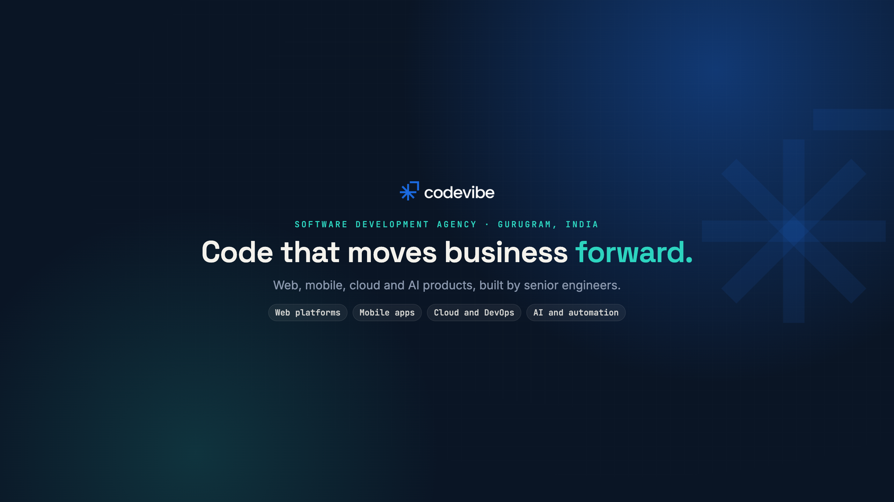

# Codevibe brand kit

Images for Codevibe Technology's public profiles, in the brand system used across codevibe.in: navy `#0A1525`, blue `#1B6AE0`, teal `#2DD4BF`, off-white `#F4F2EC`; Space Grotesk, Inter and JetBrains Mono.

| File | Size | Where it goes |
| --- | --- | --- |
| `social/youtube-banner.png` | 2560 x 1440 | YouTube channel banner. All text sits inside the 1546 x 423 area every device shows. |
| `social/x-header.png` | 1500 x 500 | X (Twitter) header. The left side is kept clear for the profile picture. |
| `social/linkedin-cover.png` | 2256 x 382 | LinkedIn company page cover (1128 x 191 at 2x). The left side is kept clear for the page logo. |
| `social/avatar.png` | 800 x 800 | Profile picture for Gravatar, npm and any platform that needs a square logo. |
| `social/youtube-watermark.png` | 300 x 300 | YouTube video watermark. |

Every PNG has a matching `.svg` source in the same folder. The SVGs are self-contained (fonts subset and inlined, logo embedded), so they render the same in any browser and can be exported at any size.

