  

  
  
  
  
  
  

 

We are a software development agency in Gurugram, India. Our team of senior engineers designs, builds and runs web platforms, mobile apps and AI features for startups and growing businesses in India, the US, the UK and the UAE. Most of our work is client code in private repositories. What you see here is what we open-source along the way.

## What we build

<table>
  <tr>
    <td width="33%" valign="top">
      <b>Web platforms</b> 
      Next.js, React and NestJS products, from fast marketing sites to multi-tenant SaaS, CRMs and admin panels.
    </td>
    <td width="33%" valign="top">
      <b>Mobile apps</b> 
      React Native, Expo and Flutter apps for iOS and Android, with native Swift and Kotlin where it matters.
    </td>
    <td width="33%" valign="top">
      <b>AI and automation</b> 
      LLM features, RAG chat, document generation and workflow automation wired into the systems you already run.
    </td>
  </tr>
  <tr>
    <td width="33%" valign="top">
      <b>Cloud and DevOps</b> 
      AWS, Google Cloud, Azure and Vercel. Docker, CI/CD on GitHub Actions, monitoring and cost control.
    </td>
    <td width="33%" valign="top">
      <b>UI/UX and motion</b> 
      Product design in Figma, Framer sites and motion design that ships with the product.
    </td>
    <td width="33%" valign="top">
      <b>Speed and search</b> 
      Core Web Vitals, technical SEO and visibility in AI search (ChatGPT, Perplexity, Google AI Overviews).
    </td>
  </tr>
</table>

## Open source

<table>
  <tr>
    <td width="50%" valign="top">
      
      <h3><a href="https://github.com/codevibe-technology/ai-bot-access">ai-bot-access</a></h3>
      
Checks whether GPTBot, ClaudeBot, PerplexityBot and 12 more AI crawlers can actually read your pages: robots.txt rules plus a real request with each bot's user agent.

      <pre lang="sh">npx ai-bot-access https://your-site.com</pre>
      
      
      
    </td>
    <td width="50%" valign="top">
      
      <h3><a href="https://github.com/codevibe-technology/next-deferred-tags">next-deferred-tags</a></h3>
      
Loads Google Tag Manager, GA4, Meta Pixel and LinkedIn Insight on the first interaction in Next.js. Events and page views are queued, nothing is lost.

      <pre lang="sh">npm i next-deferred-tags</pre>
      
      
      
    </td>
  </tr>
</table>

Issues and pull requests are welcome on both. Each repo has a contributing guide.

## Stack we work in

  

## How we work

- **Senior engineers only.** The people you talk to are the people writing your code.
- **Fixed price or monthly.** A fixed scope at a fixed price, or a dedicated team billed monthly.
- **Replies within 12 hours** on working days, Monday to Friday, 10 AM to 7 PM IST.
- **30+ products shipped**, and every client so far has come back to us for more work.

## Work with us

Have a product to build, or a site that needs to be faster? Write to **[hello@codevibe.in](mailto:hello@codevibe.in)** or start at **[codevibe.in](https://codevibe.in)**.

 

  <a href="https://codevibe.in">
    <picture>
      <source media="(prefers-color-scheme: dark)" srcset="https://raw.githubusercontent.com/codevibe-technology/ai-bot-access/main/.github/assets/codevibe-logo-light.png">
      
    </picture>
  </a>
   
  Codevibe Technology Private Limited &nbsp;·&nbsp; Gurugram, India

